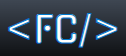

<div align="center">



# Franco Cornejo — Portfolio

**Full Stack Developer | React Frontend Developer | QA Manual Tester | AI Platform Engineer**

[](https://react.dev)
[](https://vitejs.dev)
[](https://tailwindcss.com)
[](https://www.framer.com/motion)
[](#)

</div>

---

## Descripción

Portfolio personal diseñado y desarrollado desde cero como una SPA (Single Page Application) moderna, con identidad visual propia, animaciones con propósito y una estructura estratégica orientada a oportunidades como **Full Stack Developer**, **React Frontend Developer**, **QA Manual Tester** y **AI Platform Engineer**.

No solo muestra proyectos — demuestra cómo construyo productos web de punta a punta: del frontend en React al backend y la base de datos, los valido con testing manual (QA) y potencio el flujo con desarrollo asistido por IA.

---

## Secciones

| Sección | Descripción |
|---|---|
| **Hero** | Presentación con gradient mesh animado, badge de disponibilidad y CTAs |
| **Sobre mí** | Bio profesional con snippet de código decorativo y stats animados |
| **Experiencia** | Trayectoria profesional con timeline animado y rol actual destacado |
| **Stack & Tools** | Grid de tecnologías (frontend, backend y bases de datos) y herramientas |
| **Proyectos** | 3 casos de estudio reales con contexto, desafío, rol y decisiones UX/UI |
| **Mi enfoque** | Propuesta de valor: del frontend a la base de datos, con IA como multiplicador |
| **Currículum** | PDFs descargables en español e inglés con vista previa |
| **Contacto** | CTA con dropdown para contactar por WhatsApp o Gmail |

---

## Stack técnico

```
Framework      →  React 19 + Vite 7
Estilos        →  Tailwind CSS 3 + CSS custom properties
Animaciones    →  Framer Motion 12
Iconos         →  Lucide React + React Icons
Fuentes        →  Sora · Inter · JetBrains Mono (Google Fonts)
i18n           →  Context API propio (ES / EN, persistido en localStorage)
Deploy         →  Vercel
```

---

## Características destacadas

- **Dark mode premium** — paleta `#08080E` con acentos `#6C63FF` (índigo) y `#00D4FF` (cyan)
- **Gradient mesh animado** — orbs con CSS keyframes en el hero
- **Animaciones con Framer Motion** — stagger de entrada, scroll reveals con `useInView`, hover physics
- **Sección de experiencia** — timeline con nodo pulsante y badge de rol "Actual"
- **Casos de estudio** — proyectos presentados con contexto, desafío, rol y decisiones de UX/UI
- **Bilingüe** — sistema de i18n propio con persistencia en localStorage (ES / EN)
- **Responsive** — mobile-first, breakpoints md/lg
- **Dropdown de contacto** — WhatsApp + Gmail con AnimatePresence

---

## Arquitectura

Todo el contenido textual (ES / EN) está centralizado en [`src/lib/i18n.jsx`](src/lib/i18n.jsx) y las secciones lo consumen vía el hook `useI18n()`. Esto mantiene el copy desacoplado de los componentes y hace trivial sostener el sitio bilingüe.

```
src/
├── components/        → Secciones: Hero, About, Experience, TechGrid, Projects, UXUI, Resume, Footer
│   └── ui/            → Primitivos reutilizables (button, card)
├── lib/
│   ├── i18n.jsx       → Contenido ES/EN + provider de idioma
│   └── utils.js       → Helpers (cn / clsx + tailwind-merge)
├── data/              → Datos estáticos de secciones
└── assets/            → Imágenes de proyectos y branding
```

---

## Instalación local

```bash
# Clonar el repositorio
git clone https://github.com/francocor/NuevoPorfolio.git
cd NuevoPorfolio

# Instalar dependencias
npm install

# Iniciar servidor de desarrollo
npm run dev

# Build para producción
npm run build

# Preview del build
npm run preview
```

---

## Proyectos incluidos

### Harmonia
Sistema de gestión de historias clínicas para médicos independientes y consultorios privados.
`React` · `Node.js` · `Express` · `PostgreSQL` · `Tailwind CSS` · `Figma`

### Hospital San Pablo
Sistema de gestión hospitalaria — admisiones, turnos y administración interna.
`React` · `JavaScript` · `Node.js` · `MySQL`

### Nefrogen
Plataforma de gestión para clínica de nefrología — pacientes, tratamientos y evolución clínica.
`React` · `Node.js` · `MySQL` · `Tailwind CSS`

---

## Contacto

**Franco Cornejo** — Full Stack Developer · React Frontend · QA Manual · AI Platform Engineer
📧 [Francocornejoc15@gmail.com](mailto:Francocornejoc15@gmail.com)
📱 [+54 9 381 634-8569](https://wa.me/5493816348569)
💼 [LinkedIn](https://linkedin.com/m/in/franco-cornejo-3b3aaa209/)
🐙 [GitHub](https://github.com/francocor)

---

<div align="center">
  <sub>Diseñado y construido por Franco Cornejo · 2025 / 2026</sub>
</div>
